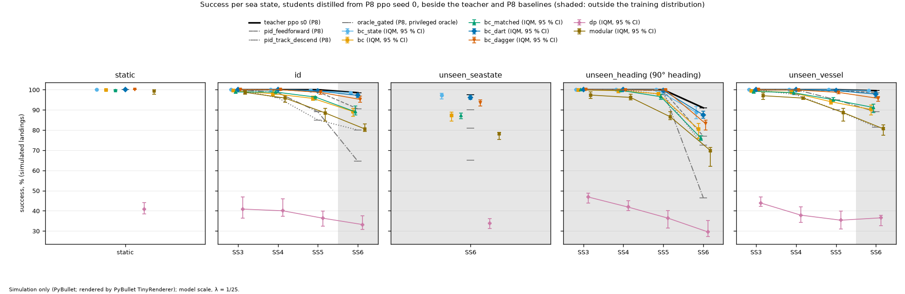
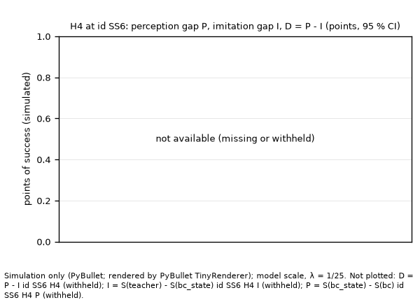
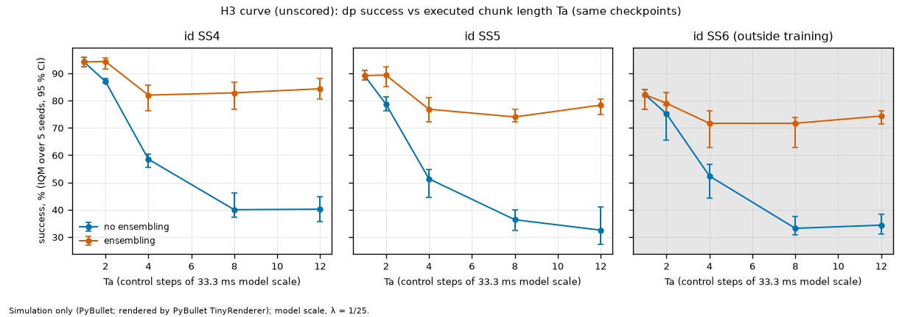

# imitation-landing-approach

Vision-based imitation learning for quadrotor landing on a heaving ship deck, **in simulation**.

A privileged, state-based teacher from
[`rl-land-on-moving-deck`](https://github.com/kbasak01/rl-land-on-moving-deck) ("P8"; a pinned,
read-only submodule in `external/`) is distilled into students that see images rendered by
PyBullet's TinyRenderer. The students are:
- behaviour cloning (BC);
- DART;
- DAgger;
- a Diffusion Policy;
- a modular estimate-then-act pipeline.

They fly P8's frozen episode lists, under P8's frozen success criteria and statistics, with P8's
teacher and classical baselines printed beside every student.

The physics is PyBullet through gym-pybullet-drones, as in P8. Lengths, times and speeds are model
scale (λ = 1/25) unless stated. Full scale is ×5 for time and speed and ×25 for length.

**Everything in this repository is simulation. No camera, vehicle or deck outside the simulator
was used, and no sim-to-real claim is made.**

**Status: Phases 0–10 complete (Gate 10 passed 2026-11-09). Phase 11, publication, is pending.**

**Gate history.** Each gate is dated in [`docs/protocol.md`](docs/protocol.md).
- **Gate 0** failed its first attempt on 2026-10-27 and passed the same day. At the first attempt,
  CI could not be verified because no GitHub remote existed yet, and `results/p8_provenance.json`
  was not yet committed.
- **Gate 2** failed its first attempt on 2026-10-27 and passed the same day. At the first attempt:
  - no committed artifact showed that frames were rendered during the reproduction gate;
  - `privileged-leak-auditor` returned a RISK, closed in `e54fa2e`.
- **Gates 1 and 3–8** passed at their first attempt.
- **Gate 9** passed with `dp`'s closed-loop export parity **failed**: 32–44 of 150 flips on the
  scored providers, against a bound of ≤ 3. Gate 9 recorded the test as run as frozen, and H5(a)
  is not supported (P10-D1 item 4).
- **Gate 10** passed after the validation sweep (P10-D1, P10-D2). In it, core `dp` seeds 0–4 were
  re-rated from TRUSTWORTHY to CAVEAT; no number changed.

**Recorded deviations**, each dated with its reason in `docs/protocol.md`:
- the camera far plane is 20 m, not 5 m (P1-D1);
- the determinism study flew the 150 `select` episodes, not 200 (P2-D3);
- `bc_dart` seed 0 is the σ-tuning trial (P4-D5 item 2);
- held-out loss uses `train` `ppo_2000` episodes 1950–1999, not `tune` demos (P4-D5 item 3);
- the R1 LeRobot environment gains extras (P6-D2);
- R1 trains even though its smoke test failed at 6/8 (P6-D4);
- the modular estimation-error study uses its own data (P7-D2).

The checklist walk, with a verdict and evidence for every line, is in
[`docs/LIMITATIONS.md`](docs/LIMITATIONS.md). The full audit is in
[`docs/audit_report.md`](docs/audit_report.md). The complete result tables are in
[`results/results.md`](results/results.md); `make report` re-renders it byte-identically from
committed files.

## The short version

Everything below is in simulation:
- Every core student is distilled from P8 `ppo` seed 0.
- H2's `bc_mix` and `dp_mix` learn from `T_mix`, which is P8 `ppo` seed 0 plus `gated`, assigned
  per episode.
- There are seven pre-registered hypothesis contrasts, scored as frozen in P3-D1, with no
  multiplicity correction (P3-D1 §1).
- Every SS6 contrast carries P8's one-ulp flip floor: 6.6 % of `id` SS6 policy-episodes flip under
  at least one of 20 one-ulp draws (single-draw median 1.9 %). It was measured on P8's MLPs, not on
  these students.
- Sources: `results/e08/hypotheses.csv` and `hypotheses.json` (verdicts and caveats), and
  `results/results.md` §2 and §5.

| hypothesis | cell | contrast | estimate [95 % CI] | margin | verdict |
|---|---|---|---|---|---|
| H1 compounding error | `id` SS5 | `bc_dagger` − `bc_matched` (2 000 labelled each) | +2.6 [+0.6, +4.8] points | +5 | **inconclusive** (ceiling-limited) |
| H1 secondary | `id` SS6 † | same | +5.9 [+2.3, +9.7] points | +5 | **supported** |
| H1 DART secondary | `id` SS5 | `bc_dart` ‡ − `bc` (1 000 labelled each) | +3.6 [+1.7, +5.8] points | +5 | **inconclusive** (ceiling-limited) |
| H1 DART secondary | `id` SS6 † | same | +8.1 [+4.6, +11.9] points | +5 | **supported** |
| H2 multimodality | `id` SS4 | W₁(`bc_mix`, ref) − W₁(`dp_mix`, ref), touchdown time | +0.088 [−0.100, +0.263] s, model scale | +0.033 s | **not supported** |
| H3 chunk length | `id` SS6 † | `dp` Ta = 1 − Ta = 8, same checkpoints | +47.4 [+41.0, +53.8] points | +5 | **supported** |
| H4 shortfall | `id` SS6 † | D = P − I (perception − imitation gap) | +9.4 [+5.6, +13.5] points | D > 0 | **supported** |
| H5(a) latency | `dp` export, batch 1 | p99 < 33.3 ms on a provider passing both parities | no provider passes | — | **not supported** |
| H5(b) latency in the loop | `id` SS5 | `dp` with d = 6 − `dp` synchronous | −15.9 [−21.5, −10.5] points | CI ≥ −3 | **not supported** |

† SS6 is outside the training distribution; the 6.6 % one-ulp flip floor applies.
‡ `bc_dart` seed 0 is the σ = 0.10 tuning trial, kept as frozen (P4-D5 item 2). The
sensitivity on seeds 1–4 alone is post hoc: added after `select`, before any frozen-list read; it is
never substituted and given no verdict (`results/e08/bc_dart_s1_4.csv`; `results/results.md` §2 and
§5).
- IQM: 99.2 [99.0, 99.5] at `id` SS5 and 97.0 [96.0, 97.5] at SS6.
- H1 DART, `bc_dart` seeds 1–4 − `bc` seeds 0–4: +3.5 [+1.6, +5.7] at SS5 and +8.0 [+4.3, +11.9]
  at SS6.

- **Near the teacher at SS3–SS5 (unpaired reading).** On the frigate (`id`), the vision students
  trained with on-policy or noise-injected data land close to the teacher:
  - `bc_dagger` lands 100.0 / 100.0 / 98.7 % (IQM over 5 seeds);
  - `bc_dart` lands 100.0 / 100.0 / 99.3 %;
  - the teacher lands 200/200 in each cell.
- **This `dp` is far below.** This `dp`, distilled from P8 `ppo` s0, lands 33–41 % (IQM) in every
  `id` cell at its frozen inference (Ta = 8, K = 10). Most of its losses are `off_pad`.
- **H1 is led by its primary, which is inconclusive.**
  - The CI excludes 0, but +2.6 is below the +5 margin.
  - The cell is ceiling-limited: `bc_matched` lands 960/1 000 (mean over seeds × episodes; IQM
    96.3), so +5 was unattainable.
  - The SS6 secondary clears +5 by 0.9 points (+5.1 with tunnelled successes removed).
  - The DART secondaries compare equal labelled-episode counts. σ* = 0.10 was chosen on `select`
    over 3 seed-0 trials; `bc` was not tuned.
- **H3.** Executing 1 action per replan instead of 8 lands +47.4 points more on the same `dp`
  checkpoints, which were selected at Ta = 8.
  - At Ta = 8, `dp` lands 41.0 % (410/1 000, mean over seeds × episodes) on the static deck, about
    as often as at `id` SS3–SS4 (40.8 %, 40.0 % IQM; unpaired reading). So the loss cannot be
    attributed to deck motion.
  - The results are *consistent with* a stale `last_action` copycat channel. Feeding `dp` its own
    executed previous action raises open-loop lateral RMSE by 29–38 % (P7-D3 item 7). That is a
    competing explanation to chunk length.
  - Seed 0's `dp` flips 21–29 % of 150 `select` outcomes under numeric perturbations of order 1e-5
    (P9-D2 item 1).
  - On `select` at Ta = 1, `dp` lands a mean of 139.0/150, still below `bc`'s 145–149 in every seed
    (unpaired; P6-D5).
- **H4.** The **perception gap** P = S(`bc_state`) − S(`bc`) is +9.5 [+6.1, +13.3]. The
  **imitation gap** I = S(teacher) − S(`bc_state`) is +0.1 [−1.1, +1.4], and it is ceiling-limited.
  P also includes:
  - withholding `time_fraction` from the vision student;
  - `bc_state`'s fp32 training against `bc`'s bf16.
- **H5(a).**
  - No scored provider passes open- and closed-loop parity for `dp`.
  - Every scored `dp` end-to-end batch-1 p99 is above the 33.3 ms control period: 52.6 to
    122.9 ms, on this machine (RTX A4000, WSL2).
  - The unscored ORT TensorRT fp32 p99 is 25.7 ms, but it fails closed-loop parity (46/150).
- **H5(b).** It compares `dp` with itself: 36.1 % synchronous vs 20.2 % with a 6-step delay (mean
  over seeds × episodes).
  - d = 6 is the delay of the 1-thread CPU fallback, not of a GPU.
  - The delayed side includes 6 zero-action steps at episode start.
  - `last_action` then carries the delayed action, which the student never saw in training.
  - There is no teacher-under-delay reference.
- **`modular`** (an estimator plus the frozen teacher, which is given the true `time_fraction`)
  sits below its teacher:
  - −11.9 [−16.3, −8.0] points at `id` SS5;
  - −17.6 [−22.0, −13.3] at `id` SS6, with the flip floor above
    (`results/e08/contrasts.csv`, teacher checks).
  - Its state-estimation error falls at or slightly above P8's 2 cm / 0.10 m/s perception-noise
    condition and below 4 cm / 0.20 m/s (P7-D3 item 3).
- **Selection** on `select` is noise-dominated near the ceiling, so the selected scores are
  optimistic. Held-out loss is not a selection proxy (P6-D5).

## Results: success against sea state



*Figure: success against sea state on all five lists.* Core students are IQM over 5 seeds; the
teacher and baselines are point rates from P8's committed rows (their Wilson CIs are in the table).
SS6 is outside training. In simulation; the data is in
`results/e08/figures/success_vs_seastate.csv`.

**The `id` list** (frigate, aft pad, JONSWAP; `results/results.md` §2):
- **Cells** are success %.
  - Students: IQM [stratified-bootstrap 95 % CI] over seeds, N = 1 000 seed-episodes (5 × 200).
  - Baselines: rate [Wilson 95 %], k/200.
- **Losses** by class are in `results/results.md` §2–§3.

| arm | SS3 | SS4 | SS5 | SS6 † |
|---|---|---|---|---|
| `bc_state` (P8's 25-d state observation incl. `time_fraction`, BC; privileged by design) | 100.0 [100.0, 100.0] | 100.0 [100.0, 100.0] | 99.7 [99.5, 100.0] | 98.5 [97.8, 98.8] § |
| `bc` (vision BC, 1 000 demos) | 99.5 [99.0, 100.0] | 98.0 [97.0, 99.3] | 95.7 [94.7, 96.8] | 89.2 [86.7, 90.8] |
| `bc_matched` (vision BC, 2 000 demos) | 98.8 [98.2, 99.7] | 98.8 [97.7, 99.8] | 96.3 [95.0, 96.5] | 89.0 [87.5, 91.8] |
| `bc_dart` ‡ (vision BC, DART σ* = 0.10) | 100.0 [99.7, 100.0] | 100.0 [99.7, 100.0] | 99.3 [99.0, 99.5] | 97.2 [96.2, 97.5] |
| `bc_dagger` (vision BC + DAgger, 2 000 labelled) | 100.0 [100.0, 100.0] | 100.0 [99.7, 100.0] | 98.7 [97.7, 99.5] | 95.2 [93.8, 96.8] |
| `dp` (vision Diffusion Policy, Ta = 8, K = 10) | 40.8 [36.3, 46.8] | 40.0 [37.2, 46.0] | 36.3 [32.3, 39.8] | 33.2 [30.8, 37.5] |
| `modular` (estimator + frozen teacher; true `time_fraction` to the teacher) | 98.7 [97.7, 99.7] | 95.8 [93.8, 97.0] | 88.5 [84.5, 90.8] | 80.5 [79.3, 83.0] |
| teacher `ppo` s0 (P8) | 100.0 [98.1, 100.0] 200/200 | 100.0 [98.1, 100.0] 200/200 | 100.0 [98.1, 100.0] 200/200 | 98.5 [95.7, 99.5] 197/200 |
| `pid_feedforward` (P8) | 100.0 [98.1, 100.0] 200/200 | 100.0 [98.1, 100.0] 200/200 | 99.0 [96.4, 99.7] 198/200 | 90.5 [85.6, 93.8] 181/200 |
| `pid_track_descend` (P8) | 100.0 [98.1, 100.0] 200/200 | 96.0 [92.3, 98.0] 192/200 | 85.0 [79.4, 89.3] 170/200 | 80.0 [73.9, 85.0] 160/200 |
| `oracle_gated` (P8; privileged commit-timing oracle, not a bound) | 100.0 [98.1, 100.0] 200/200 | 98.5 [95.7, 99.5] 197/200 | 89.0 [83.9, 92.6] 178/200 | 64.5 [57.7, 70.8] 129/200 |

† SS6 is outside the training distribution. No SS6 or 90° episode was used in any training, tuning
or selection. ‡ `bc_dart` seed 0 is the σ-tuning trial (see above). § One seed is above the
teacher; this was audited (below).

- **Ceiling.** The teacher lands 100 % at SS3–SS5, so those cells can only show a student losing to
  it.
- **Other lists and measures** (`results/results.md`):
  - the `static`, `unseen_seastate`, `unseen_heading` and `unseen_vessel` lists (§2);
  - all six outcome classes (§3);
  - secondary metrics (§4);
  - the tagged sections (§7): the Ta and K sweeps, appearance shift, ablations, the R1 LeRobot
    reference (never mixed into the core tables) and the latency arm.
- **Students above their own teacher.** In six cells a student, or one of its seeds, sits above its
  own teacher:
  - three `bc_state` SS6 cells;
  - two `bc_mix` cells;
  - one appearance-shift cell.

  Each was audited for touchdowns and exploits, then released by `results-skeptic` before reporting
  (`results/e08/above_teacher/audit.md`).

> **What a rendered camera can and cannot show.**
> - **The image.** Each frame is a 96 × 96 TinyRenderer rasterisation (PyBullet) of a recoloured
>   ground and a marked deck, from a camera fixed to the vehicle body.
> - **Not modelled:** sensor noise, motion blur, exposure change, rolling shutter, a lens model,
>   weather and spray.
> - **Appearance shift.** The test covers five render variants only: hue, light, contrast, and ±2°
>   mount tilt (`results/results.md` §7c). Robustness claims stay inside them.
> - **Frames at contact.** Once the vehicle rests on the deck, the camera (`offset_body_m` −0.02 m,
>   model scale) sits below the deck surface, and every frame is uniform background until the
>   episode ends. Physics and outcomes are unaffected. The demo stores contain the same frames, and
>   the GIFs show it at every touchdown.

## Where the shortfall comes from (H4) and the chunking curve (H3)



*Figure: the perception gap P = S(`bc_state`) − S(`bc`) and the imitation gap
I = S(teacher) − S(`bc_state`) at `id` SS6 (`results/e08/figures/h4_gaps.csv`; in simulation;
P8's SS6 one-ulp flip floor is 6.6 %).*
- The imitation gap is near 0, and it is ceiling-limited: the teacher is at 98.5 %.
- Almost all of `bc`'s SS6 shortfall is in the step from state to pixels. That step also removes the
  clock, and it changes training from fp32 to bf16.



*Figure: success of this `dp` (distilled from P8 `ppo` s0) against executed chunk length Ta, on the
same checkpoints, with K = 10 (`results/e08/figures/h3_ta_curve.csv`; in simulation).*
- Shorter chunks recover most of the loss.
- A stale `last_action` input is a competing explanation (P7-D3).
- At Ta = 8, `dp` lands about as often on the static deck as at `id` SS3–SS4 (unpaired reading).
- The checkpoints were selected at Ta = 8.

## Deployment: ONNX export and latency (Phase 9)

`bc_dagger` (seed 0) and this `dp` (seed 0) were exported to ONNX: opset 17, fp32 and fp16, with
the noise as an input and no RNG op. Each was checked for parity and timed with P8's latency
harness:
- at least 200 warm-up calls, then at least 2 000 timed, synchronised calls;
- batch 1, with one thread on CPU.

Wall clock is on this machine (Intel i9-10980XE, RTX A4000, WSL2), not Froude-scaled. Nothing here
transfers to an embedded target. Sources: `results/latency/latency.csv`, `parity.csv`,
`closed_loop.csv`, `delay.json`.

| provider | `bc_dagger` e2e p50 / p99 (ms) | `dp` e2e (K = 10) p50 / p99 (ms) | `dp` closed-loop flips / 150 |
|---|---|---|---|
| torch CPU fp32 (reference, 1 thread) | 28.6 / 33.4 | 166.3 / 181.3 | reference |
| ORT CPU fp32 (1 thread) | 15.8 / 17.8 | 111.6 / 122.9 | 33 |
| ORT CUDA fp32 | 3.0 / 6.0 | 48.3 / 52.6 | 44 |
| torch CUDA fp32 | 3.7 / 4.3 | 80.7 / 89.4 | 32 |
| ORT TensorRT fp32 (unscored) | 1.2 / 1.8 | 19.8 / 25.7 | 46 |
| ORT TensorRT fp16, ORT CUDA fp16 | refused: open-loop parity failed | refused | — |

- **Open-loop parity.** On 1 000 teacher-visited `select` inputs, the three scored fp32 providers
  pass for both arms against a bound of 1e-4: `dp` per-step ε̂ ≤ 2.96e-5, `bc_dagger` action
  ≤ 3.04e-6.
- **Closed-loop parity** (≤ 3 of 150 flips) **passes for `bc_dagger`** (0–2 flips) and **fails for
  `dp`** (32–44 on the three scored providers; 46 on the unscored TensorRT fp32).
  - `torch_cuda_fp32` runs the same Python sampler as the reference and still flips 32 episodes.
  - So this `dp`'s outcomes are sensitive to numeric perturbations of order 1e-5, while its success
    counts stay near the reference: 58–67 of 150, against 63.
- **The delay d.** d = ⌈p99 / 33.333 ms⌉ control steps, from the fastest **scored** provider that
  passes both parities; if none passes, the torch CPU fallback is used.
  - `bc_dagger`: d = 1 (torch CUDA, 4.32 ms).
  - `dp`: d = 6 (fallback, 181.3 ms).
  - d = 2 under ORT CUDA was not flown.

## Gallery (hand-picked by a stated rule)

These GIFs are **hand-picked by the rule in [`results/e08/gifs/RULE.md`](results/e08/gifs/RULE.md)**,
which was fixed before any GIF was made.
- **Panels:** teacher, `bc`, `bc_dagger` and `dp`, all seed 0.
- **Checked:** every panel was re-flown and asserted equal to its committed row before it was
  written.
- **Frames:** rendered (PyBullet TinyRenderer) at 96 × 96 px, in simulation. They turn uniform
  background once the vehicle rests on the deck (see the box above).
- **Use:** they illustrate only; no rate is read from them.

| (a) all four land, `id` SS5 | (b) the students split, `id` SS5 |
|---|---|
|  |  |
| **(c) `dp` lands off the pad, `id` SS5** | **(d) the teacher fails, `id` SS6** |
|  |  |

Panel (d) is a single episode. In it the teacher lands hard, `bc` and `bc_dagger` succeed, and `dp`
lands `off_pad`. It is not a rate. The audited cells where a student sits above its teacher are in
`results/e08/above_teacher/`.

## Setup in brief

- **P8 provides** the environment, teacher and protocol, at commit `7237b70`, verified by
  `make verify-p8`:
  - frozen-lists MANIFEST `e6f30e55…`;
  - success YAML `c7fbdcc4…`;
  - the `ppo` seed-0 checkpoint with its frozen VecNormalize.
- **Success** (model scale) needs all four:
  - closing speed along the deck normal ≤ 0.5 m/s;
  - lateral offset ≤ 0.10 m;
  - relative tilt ≤ 15°;
  - contact ≥ 0.5 s.

  Every episode ends in one of six outcome classes: success, crash, off_pad, hard_landing, bounce
  or timeout.
- **What a vision student sees:**
  - Two 96 × 96 RGB frames, rendered (PyBullet TinyRenderer) after each physics step from the same
    state as the observation.
  - A 13-d proprioceptive allowlist (`configs/obs/student.yaml`).
  - Never relative position, relative velocity, deck normal, relative tilt or height.
  - Never `time_fraction`, except in the labelled `+clock` ablation.

  `modular`'s estimator sees the same inputs; its frozen teacher is given the true `time_fraction`
  (P3-D1 §3). `bc_state` sees P8's 25-d observation and is privileged by design.
- **The rendered scene.** The ground plane is recoloured, so no world-fixed texture appears in a
  frame. The deck marking is a visual-only body with no collision shape.
- **Rendering does not change physics.** With render on, P8's `pid_feedforward` (2 800) and `ppo`
  seed 0 (400) rows reproduce bit for bit. This was re-run at `8f4c9e0`
  (`results/reproduce_p8/rerun_phase10/`); `runner.py` and `p8_adapter.py` are unchanged since.
- **Demonstrations** come from P8's `train` pool only. Success filtering kept
  (`results/demos_summary.json`):

  | demonstrations | kept |
  |---|---|
  | `ppo` | 1 999 / 2 000 |
  | `pid_feedforward` | 998 / 1 000 |
  | `T_mix` | 978 / 1 000 |

  DART stores are not filtered, by design.
- **Matched data.** `bc_dagger` and `bc_matched` have 2 000 labelled episodes per seed each, and
  `bc_dart` and `bc` have 1 000 each.
- **Selection and tuning.** Checkpoints are selected only on `splits/select.parquet`, from P8's
  `tune` pool. The one tuning search is DART σ, over 3 trials.
- **Seeds.** Core arms have five seeds and ablations three; none was dropped.
- **Statistics.**
  - Students get the IQM with stratified-bootstrap 95 % CIs.
  - Contrasts use the paired bootstrap.
  - Wilson, IQM and paired-bootstrap functions are P8's, by identity (tested).
  - Three statistics are this repository's, each with known-answer tests (`ila.eval.stats`; P3-D1
    §1): the joint-seed contrast (H3, H5(b)), the W₁ bootstrap (H2) and the three-arm bootstrap
    (H4).
  - Sea states are never pooled, and no multiplicity correction is applied.
- **Evaluation path.** Every evaluation row was flown on the CPU fp32 single-sample path: 185 200
  rows (`results/e08/run_info.json`) in 961 cells (`results/e08/summary.csv`).

## Limitations

[`docs/LIMITATIONS.md`](docs/LIMITATIONS.md) has these with their evidence (L1–L9 there; wording
condensed here).

- **L1 Simulation only.** PyBullet physics, TinyRenderer images and P8's seakeeping motion. Nothing
  was flown, filmed or measured outside the simulator.
- **L2, L3 The rendered camera.** See the box above.
- **L4 Outcome sensitivity of the Diffusion-Policy students.** Seed 0 of each arm was flown on
  `select` (`results/phase10/dp_sensitivity/sensitivity.csv`, P10-D2). The perturbation is the same
  sampler run in torch on the GPU against the CPU reference, with numeric differences of order 1e-5.

  | arm | flips of 150 |
  |---|---|
  | `dp` | 32 |
  | `dp_mix` | 22 |
  | `dp_pid` | 5 |
  | `dp_n100` | 43 |
  | `dp_n300` | 35 |
  | `dp_minus_last_action` | 37 |

  - `dp`'s 32 reproduces Phase 9 exactly.
  - Every reference flight equals its selection rows byte for byte.
  - P8's single-draw one-ulp floor (median 1.9 %) was measured on P8's MLPs under a different
    perturbation, so it is context, not a like-for-like bound.
  - Byte-identical rows for `dp`, `dp_*` and R1 hold only on this software stack: torch 2.13.0 on
    the CPU fp32 single-sample path, and for R1, ONNX Runtime CPU with one thread.
- **L5 Ceilings and thin margins.**
  - The teacher is at 100 % at SS3–SS5, so both H1 primaries are ceiling-limited.
  - Beyond the +5 margin, H1-SS6 clears by 0.9 points and H1-DART-SS6 by 3.1 points. The flip floor
    at SS6 is 6.6 %, measured on P8's MLPs.
  - Every core student comes from one teacher seed, P8 `ppo` seed 0.
- **L6 Latency.**
  - Latency is wall clock on one workstation (RTX A4000, WSL2), not Froude-scaled.
  - H5(b)'s d = 6 is the CPU fallback's delay.
  - `bc_dagger`'s delay cost is one control step: 33.3 ms model scale, 166.7 ms full scale. There
    is no teacher-under-delay control.
- **L7 Parity inputs** are teacher-visited `select` states, not student-visited ones.
- **L8 Tuning asymmetry.** `bc_dart` had the one permitted search (σ over 3 trials on `select`,
  decided by one episode); `bc` had none.
- **L9 Tunnelled successes.** P8 counts a success even when the touchdown penetration exceeds 5 mm.
  The H1 and H1-DART contrasts print success minus tunnelled successes beside them. Tunnelled
  successes favour the Ta = 8 side of H3, so its direction stands.
- **Not covered:** other teachers or teacher seeds for the core arms, other vessels in training,
  sensor models beyond TinyRenderer, and any embedded target.

## Reproducing this

**Install.** Python 3.12, with build-essential and python3.12-dev, because pybullet builds from
sdist. These are CI's steps (`.github/workflows/ci.yml`):

```bash
git clone --recursive https://github.com/kbasak01/imitation-landing-approach
cd imitation-landing-approach          # in an existing clone: git submodule update --init --recursive
python3.12 -m venv .venv && . .venv/bin/activate
P8=external/rl-land-on-moving-deck
pip install -e $P8/third_party/deck-motion-forecast
pip install -e $P8/third_party/gym-pybullet-drones
pip install -e "$P8[dev]"
pip freeze --exclude-editable > /tmp/p8_constraints.txt
pip install -c /tmp/p8_constraints.txt -e ".[dev]"   # P8's pins as constraints: torch is never re-resolved
```

**From committed files alone** (no checkpoints, no demo store, no GPU). CI runs all of these:

```bash
make lint                                                     # ruff + mypy --strict
pytest -m "not gpu and not checkpoints and not data and not slow"
make report                                                   # results/results.md, byte-identical
make bench-check                                              # results/latency tables, byte-identical
make sensitivity-check                                        # results/phase10/dp_sensitivity re-checked
make figures && git diff --exit-code results/e08/figures      # figures, byte-identical
```

**What needs more than committed files:**
- **P8's `ppo` seed-0 checkpoint is not publicly released.** Its SHA-256s are in
  `results/p8_provenance.json`. It is needed for `make verify-p8`, `make reproduce-p8`, `modular`
  evaluation, DAgger and demo collection. Copy `configs/paths.local.example.yaml` to
  `configs/paths.local.yaml` and point it at P8's run directory.
- **Student checkpoints and ONNX graphs.** They are release assets: 86 files, 16.7 GiB, the largest
  470 MB.
  - Each asset's source path and SHA-256 are in `results/release/manifest.json`, and
    `results/release/SHA256SUMS.txt` verifies them: `sha256sum -c --ignore-missing SHA256SUMS.txt`
    in the download directory.
  - Asset names are flat (`<arm>_s<seed>_<file>`). The evaluation code looks each checkpoint up
    at its manifest `source` path (`artifacts/runs/…`, `artifacts/deploy/graphs/…`), so move each
    asset to that path.

| stage | wall clock (this machine) | source |
|---|---|---|
| reproduction gate (`make reproduce-p8`, 24 workers) | 253 s | `results/reproduce_p8/rerun_phase10/run_info.json` |
| demo collection (6 stores) | 52–102 s each | `results/demos_summary.json` (`manifest.wall_s`) |
| training, all 71 pinned runs plus 3 σ trials (one RTX A4000) | 95.4 GPU-h (17.5 + 7.1 + 19.8 + 51.0) | `results/phase{4,5,6,7}/runs_summary.csv` (`gpu_hours`) |
| evaluation matrix (`make eval`, CPU, 24 workers) | 22.3 h, summed over jobs | `results/e08/run_info.json` |
| `dp_*` sensitivity (`make sensitivity`) | about 2 min per arm | `results/phase10/dp_sensitivity/run_info.json` |
| `make test` (full suite, workstation) | 23 min 25 s | `docs/LIMITATIONS.md` |

The full order of operations is in the `Makefile` and `docs/IMPLEMENTATION_PLAN.md`. Long jobs are
resumable, and they refuse to start on a dirty tree. Paths inside committed run records are absolute
paths on the machine that produced them; they record provenance and are not instructions.
`CLAUDE.md`, `KICKSTART.md` and `.claude/` hold the instructions the coding agent worked under.

## How this relates to prior work

The closest prior work is Angelis, Bauersfeld, Scaramuzza and Boukas, *Vision-Based Agile Landing
on Turbulent Waters* (arXiv:2605.23717). It lands on a moving platform from a downward camera:
- PPO on 25 sparse keypoints, trained end to end;
- sinusoidal per-DoF platform motion;
- hardware tests;
- no teacher, demonstrations or distillation.

This repository is simulation-only and does not compare with it numerically.

Privileged-teacher → sensor-based-student distillation is established for driving and flight (Chen
et al. 2019; Kaufmann et al. 2020; Loquercio et al. 2021; Xing et al. 2024; Messikommer et al.
2026). So are DAgger, DART, Diffusion Policy and action chunking. **No novelty is claimed for
distillation, for Diffusion Policy, or for vision-based landing.**

What this repository adds:
1. a matched-data comparison of BC, DART, DAgger, Diffusion Policy and a modular pipeline on P8's
   frozen, seakeeping-driven protocol, with P8's classical baselines beside every student;
2. a chunk-length study at a fixed model (H3);
3. a decomposition of the shortfall into imitation and perception gaps (H4);
4. deployment numbers for the visuomotor policy, with the measured delay put back into the loop
   (H5).

P8 supplies the environment, protocol, frozen lists, success criteria, statistics and teachers.

## Documentation

| file | what |
|---|---|
| [`docs/IMPLEMENTATION_PLAN.md`](docs/IMPLEMENTATION_PLAN.md) | the plan, phase by phase, with its gates |
| [`docs/protocol.md`](docs/protocol.md) | every decision, deviation and gate, dated; P3-D1 is the frozen protocol |
| [`docs/LIMITATIONS.md`](docs/LIMITATIONS.md) | the validation checklist, line by line, with evidence |
| [`docs/audit_report.md`](docs/audit_report.md) | the Phase 10 full audit |
| [`results/results.md`](results/results.md) | every table, generated from committed files |
| [`SOURCES.md`](SOURCES.md), [`docs/LICENSES.md`](docs/LICENSES.md), [`THIRD_PARTY_NOTICES.md`](THIRD_PARTY_NOTICES.md) | sources, licences and notices |
| [`REPO_SETUP.md`](REPO_SETUP.md) | the original setup notes for the repository |

## Citations

- P8: K. Basak, *rl-land-on-moving-deck*, <https://github.com/kbasak01/rl-land-on-moving-deck>,
  commit `7237b70`.
- A. Angelis, L. Bauersfeld, D. Scaramuzza, N. Boukas, *Vision-Based Agile Landing on Turbulent
  Waters*, arXiv:2605.23717.
- D. Chen, B. Zhou, V. Koltun, P. Krähenbühl, *Learning by Cheating*, CoRL 2019.
- E. Kaufmann, A. Loquercio, R. Ranftl, M. Müller, V. Koltun, D. Scaramuzza, *Deep Drone
  Acrobatics*, RSS 2020.
- A. Loquercio, E. Kaufmann, R. Ranftl, M. Müller, V. Koltun, D. Scaramuzza, *Learning High-Speed
  Flight in the Wild*, Science Robotics 2021.
- J. Xing, A. Romero, L. Bauersfeld, D. Scaramuzza, *Bootstrapping Reinforcement Learning with
  Imitation for Vision-Based Agile Flight*, CoRL 2024.
- N. Messikommer, J. Xing, L. Bauersfeld, M. Cannici, E. Aljalbout, D. Scaramuzza, *Approximate
  Imitation Learning for Event-based Quadrotor Flight in Cluttered Environments*, arXiv:2603.07578.
- S. Ross, G. Gordon, D. Bagnell, *A Reduction of Imitation Learning and Structured Prediction to
  No-Regret Online Learning*, AISTATS 2011.
- M. Laskey, J. Lee, R. Fox, A. Dragan, K. Goldberg, *DART: Noise Injection for Robust Imitation
  Learning*, CoRL 2017.
- C. Chi et al., *Diffusion Policy: Visuomotor Policy Learning via Action Diffusion*, RSS 2023.
- T. Z. Zhao, V. Kumar, S. Levine, C. Finn, *Learning Fine-Grained Bimanual Manipulation with
  Low-Cost Hardware*, RSS 2023.
- J. Song, C. Meng, S. Ermon, *Denoising Diffusion Implicit Models*, ICLR 2021.
- P. de Haan, D. Jayaraman, S. Levine, *Causal Confusion in Imitation Learning*, NeurIPS 2019.
- C. Wen, J. Lin, T. Darrell, D. Jayaraman, Y. Gao, *Fighting Copycat Agents in Behavioral Cloning
  from Observation Histories*, NeurIPS 2020.
- J. Panerati et al., *Learning to Fly — a Gym Environment with PyBullet Physics for Reinforcement
  Learning of Multi-agent Quadcopter Control*, IROS 2021.
- R. Agarwal, M. Schwarzer, P. S. Castro, A. Courville, M. G. Bellemare, *Deep Reinforcement
  Learning at the Edge of the Statistical Precipice*, NeurIPS 2021.

## License

MIT ([LICENSE](LICENSE)). Third-party notices: [`THIRD_PARTY_NOTICES.md`](THIRD_PARTY_NOTICES.md).
