# imitation-landing-approach

**Teaching a rendered camera to land a quadrotor on a heaving ship deck, by imitating a privileged
controller, in simulation.**

[](https://github.com/kbasak01/imitation-landing-approach/actions/workflows/ci.yml)


[](LICENSE)

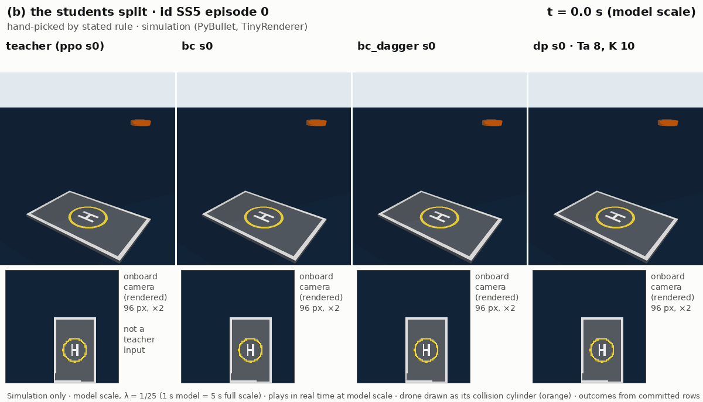

*One `id` SS5 episode, flown on the same simulated deck motion by four policies. From left to
right: the P8 `ppo` seed-0 teacher, then three of its vision students (`bc`, `bc_dagger` and `dp`,
seed 0). The top row is a third-person view. The bottom row is the 96 px frame each student sees,
rendered (PyBullet TinyRenderer). Here the teacher, `bc` and `bc_dagger` land, and `dp` lands
`off_pad`: its centre touches down more than 0.10 m from the pad centre. The episode is **hand-picked by a stated rule** ([`RULE.md`](results/e08/gifs/RULE.md)),
so it is an illustration, not a sample. Every panel was re-flown and checked equal to its committed
evaluation row before the GIF was written. Playback is real time at model scale (λ = 1/25); at full
scale the motion is 5× slower.*

> [!IMPORTANT]
> **Everything in this repository is simulation.** The physics is PyBullet through
> gym-pybullet-drones. The images are rendered by PyBullet's TinyRenderer, and the deck motion is
> P8's Froude-scaled seakeeping model. No camera, vehicle or deck outside the simulator was used,
> and no sim-to-real claim is made. Lengths, times and speeds are model scale (λ = 1/25) unless
> stated; full scale is ×5 for time and speed and ×25 for length.

## What this is

[`rl-land-on-moving-deck`](https://github.com/kbasak01/rl-land-on-moving-deck) ("P8") trained a
PPO policy that lands a simulated Crazyflie on a heaving frigate deck. That policy reads
**privileged state**: the exact relative position, relative velocity and deck normal. A camera
does not give you those. This repository asks how much of that skill survives when the policy
sees only rendered images plus a few onboard signals, and where the loss comes from.

The P8 `ppo` seed-0 policy is the **teacher**. It is distilled into **students** that see two
rendered 96 × 96 frames and a 13-d proprioceptive allowlist:
- plain behaviour cloning (`bc`, and `bc_matched` with twice the data);
- noise-injected demonstrations (`bc_dart`);
- on-policy relabelling (`bc_dagger`);
- a Diffusion Policy (`dp`);
- a modular estimate-then-act pipeline (`modular`).

Everything is flown on P8's frozen episode lists, under P8's frozen success criteria and
statistics, with P8's teacher and classical baselines printed beside every student. The study
ends with ONNX export, latency, and the measured delay put back into the loop.

## Status

**Phases 0–10 complete, Gate 10 passed 2026-11-09. Phase 11, publication, is in progress on this
branch.** Every gate is dated in [`docs/protocol.md`](docs/protocol.md):

| gate | first attempt | result | what happened |
|---|---|---|---|
| 0 setup | **failed** | passed the same day (2026-10-27) | At the first attempt, CI could not be verified because no GitHub remote existed yet, and `results/p8_provenance.json` was not yet committed |
| 1 observation contract | passed | 2026-10-27 | The leak auditor was clean on its third round |
| 2 reproduction gate | **failed** | passed the same day (2026-10-27) | No committed artifact showed that frames were rendered during the reproduction gate, and the leak auditor returned a RISK. Both were closed in `e54fa2e` |
| 3 demonstrations and protocol | passed | 2026-10-27 | P3-D1 frozen with the user's dated approval |
| 4 BC students | passed | 2026-10-29 | |
| 5 DAgger | passed | 2026-10-29 | |
| 6 Diffusion Policy | passed | 2026-11-02 | |
| 7 modular and ablations | passed | 2026-11-05 | |
| 8 evaluation matrix | passed | 2026-11-06 | It passed **without** the `bc_dart` s0 footnote and seeds 1–4 row that P4-D4 required. They were added in Phase 10 (P10-D2 item 2) |
| 9 deployment | passed | 2026-11-09 | `dp`'s closed-loop export parity **failed**: 32–44 of 150 flips on the scored providers, against a bound of ≤ 3. Recorded as run, as frozen. H5(a) is not supported |
| 10 validation sweep | passed | 2026-11-09 | Core `dp` seeds 0–4 were re-rated from TRUSTWORTHY to CAVEAT; no number changed |

<details>
<summary><b>Recorded deviations</b> (7, each dated with its reason in <code>docs/protocol.md</code>)</summary>

- the camera far plane is 20 m, not 5 m (P1-D1);
- the determinism study flew the 150 `select` episodes, not 200 (P2-D3);
- `bc_dart` seed 0 is the σ-tuning trial (P4-D5 item 2);
- held-out loss uses `train` `ppo_2000` episodes 1950–1999, not `tune` demos (P4-D5 item 3);
- the R1 LeRobot environment gains extras (P6-D2);
- R1 trains even though its smoke test failed at 6/8 (P6-D4);
- the modular estimation-error study uses its own data (P7-D2).

</details>

The validation checklist, with a verdict and evidence for every line, is in
[`docs/LIMITATIONS.md`](docs/LIMITATIONS.md): 47/47 lines, 0 unmet. The full audit is in
[`docs/audit_report.md`](docs/audit_report.md). Every result table is in
[`results/results.md`](results/results.md), which `make report` re-renders byte-identically from
committed files.

## The short version

All results are in simulation, and every core student is distilled from P8 `ppo` seed 0.

- **At `id` SS6 †, the loss is mainly in the step from state to rendered images; the imitation
  step costs almost none.** A state-based clone of the teacher loses 0.1 points [−1.1, +1.4]. The
  same recipe on rendered images loses a further 9.5 points [+6.1, +13.3]. That step also withholds
  the clock and changes training precision. H4 scores D = P − I = +9.4 [+5.6, +13.5]
  (**supported**).
- **The image students trained with on-policy (`bc_dagger`) or noise-injected (`bc_dart`) data
  land near the teacher at `id` SS3–SS5** (unpaired reading). `bc_dagger` lands
  100.0 / 100.0 / 98.7 % and `bc_dart` lands 100.0 / 100.0 / 99.3 % (IQM over 5 seeds); the teacher
  lands 200/200 in each cell.
  - Against their data-matched controls, those cells are near the ceiling, so H1's primary
    (+2.6 [+0.6, +4.8]) and its DART secondary at SS5 are **inconclusive**.
  - The SS6 † secondaries are **supported**: +5.9 [+2.3, +9.7] for DAgger and +8.1 [+4.6, +11.9]
    for DART.
- **This Diffusion Policy is far below** the other students: 33–41 % in every `id` cell at its
  frozen inference (Ta = 8, K = 10). Its main failure is `off_pad`: it touches down with its centre
  more than 0.10 m (model scale) from the pad centre. At `id` SS6 †, executing one action per replan
  instead of eight recovers +47.4 [+41.0, +53.8] points on the same checkpoints (H3,
  **supported**). A stale `last_action` input is a competing explanation.
- **A diffusion head did not match multimodal demonstrations better** than a regression head on
  this measure (H2, **not supported**: +0.088 [−0.100, +0.263] s, model scale).
  - H2's `bc_mix` and `dp_mix` learn from `T_mix`: P8 `ppo` seed 0 plus `gated`, assigned per
    episode.
- **Latency.** No scored export of `dp` passes both parity checks, and none meets the 33.3 ms
  control period at p99 (H5(a), **not supported**). Putting the measured delay back into the loop
  costs `dp` 15.9 points (H5(b), **not supported**). `bc_dagger` exports cleanly at 4.3 ms p99 on
  the GPU, on this machine (RTX A4000, WSL2).

<picture>
  <source media="(prefers-color-scheme: dark)" srcset="docs/figures/hypotheses_dark.png">
  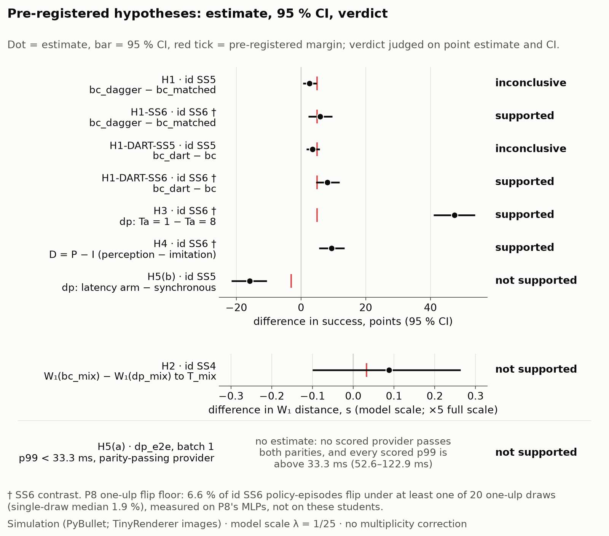
</picture>

| hypothesis | cell | contrast | estimate [95 % CI] | margin | verdict |
|---|---|---|---|---|---|
| H1 compounding error | `id` SS5 | `bc_dagger` − `bc_matched` (2 000 labelled episodes each) | +2.6 [+0.6, +4.8] points | +5 | **inconclusive** (ceiling-limited) |
| H1 secondary | `id` SS6 † | same | +5.9 [+2.3, +9.7] points | +5 | **supported** |
| H1 DART secondary | `id` SS5 | `bc_dart` ‡ − `bc` (1 000 labelled episodes each) | +3.6 [+1.7, +5.8] points | +5 | **inconclusive** (ceiling-limited) |
| H1 DART secondary | `id` SS6 † | same | +8.1 [+4.6, +11.9] points | +5 | **supported** |
| H2 multimodality | `id` SS4 | W₁(`bc_mix`, ref) − W₁(`dp_mix`, ref), touchdown time | +0.088 [−0.100, +0.263] s, model scale | +0.033 s | **not supported** ¶ |
| H3 chunk length | `id` SS6 † | `dp` Ta = 1 − Ta = 8, same checkpoints | +47.4 [+41.0, +53.8] points | +5 | **supported** |
| H4 shortfall | `id` SS6 † | D = P − I (perception gap − imitation gap) | +9.4 [+5.6, +13.5] points | D > 0 | **supported** |
| H5(a) latency | `dp` export, batch 1 | p99 < 33.3 ms on a provider that passes both parity checks | no provider passes | — | **not supported** |
| H5(b) latency in the loop | `id` SS5 | `dp` with d = 6 − `dp` synchronous | −15.9 [−21.5, −10.5] points | CI ≥ −3 | **not supported** |

Nine pre-registered verdicts were scored as frozen in P3-D1, with no multiplicity correction
(P3-D1 §1). Eight of them are contrasts with CIs; the ninth, H5(a), is a latency bound.

**† SS6 is outside the training distribution.** Every SS6 contrast carries P8's one-ulp flip floor:
6.6 % of `id` SS6 policy-episodes flip under at least one of 20 one-ulp draws (single-draw median
1.9 %). It was measured on P8's MLPs, not on these students.<br>
**‡ `bc_dart` seed 0 is the σ = 0.10 tuning trial**, kept as frozen (P4-D5 item 2). σ* = 0.10 was
chosen on `select` over 3 seed-0 trials; `bc` was not tuned. A seeds 1–4 sensitivity is below.<br>
**¶ `dp_mix` seed 0 flips 22 of 150 `select` outcomes** under numeric perturbations of order 1e-5
(L4).

<details>
<summary><b>More on ‡, ¶ and H1</b></summary>

**‡ The `bc_dart` seeds 1–4 sensitivity.**
- **What it is.** It is labelled "post hoc: added after `select`, before any frozen-list
  read". It is never substituted and is given no verdict (`results/e08/bc_dart_s1_4.csv`;
  `results/results.md` §2 and §5). It was specified in P4-D4 before any frozen-list read, but it was
  computed only in Phase 10, after Gate 8 had passed without it (P10-D2 item 2).
- **IQM:** 99.2 [99.0, 99.5] at `id` SS5 and 97.0 [96.0, 97.5] at `id` SS6 †.
- **H1 DART**, `bc_dart` seeds 1–4 − `bc` seeds 0–4: +3.5 [+1.6, +5.7] at `id` SS5 and
  +8.0 [+4.3, +11.9] at `id` SS6 †.

**¶ `dp_mix`.** The 22 of 150 is in `results/phase10/dp_sensitivity/sensitivity.csv`. The "not
measured for `dp_mix`" notes in `results/results.md` §6b and `results/e08/contrasts.csv` predate
that measurement (P10-D2 item 6).

**Why H1's primary is inconclusive.** Its CI excludes 0, but +2.6 is below the +5 margin. The cell
is ceiling-limited: `bc_matched` lands 960/1 000 (mean over seeds × episodes; IQM 96.3), so +5 was
unattainable. The secondary at `id` SS6 † clears +5 by 0.9 points (+5.1 with tunnelled successes
removed).

</details>

Sources: `results/e08/hypotheses.csv`, `hypotheses.json` and `contrasts.csv`; `results/results.md`
§2 and §5; figure data in `docs/figures/hypotheses.csv`.

## How it works

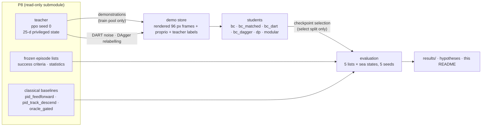

**What a vision student sees.** Each control step (33.3 ms model scale) it gets:
- **images:** two 96 × 96 RGB frames, rendered (PyBullet TinyRenderer) after each physics step from
  the same state as the observation, by a camera fixed to the vehicle body;
- **proprioception:** a 13-d allowlist (`configs/obs/student.yaml`): attitude, body rates, velocity,
  last action and contact.

It never sees relative position, relative velocity, deck normal, relative tilt or height. It never
sees `time_fraction` either, except in the labelled `+clock` ablation.
- **The ground plane is recoloured**, so no world-fixed texture appears in a frame.
- **The deck marking** is a visual-only body with no collision shape.
- **`modular`'s estimator** sees the same inputs. Its frozen teacher is given the true
  `time_fraction` (P3-D1 §3).
- **`bc_state`** sees P8's 25-d observation; it is privileged by design and exists to split the
  shortfall into gaps (H4).

**Rendering does not change physics.** With render on, P8's `pid_feedforward` (2 800 rows) and `ppo`
seed 0 (400 rows) reproduce bit for bit. This was last re-run at `3cbc039`, after Phase 11's
additions to `p8_adapter.py`: 3 200/3 200 rows identical, and `comparison.json` byte-identical to
the committed one (`results/reproduce_p8/rerun_phase11/`). Those additions are read-only spec
accessors and the visual-only outside-view grab used for the GIFs (P11-D1). `runner.py`, `render/`
and `obs/` are unchanged since Phase 10.

**Data rules:**
- **Demonstrations** come from P8's `train` pool only.
- **Checkpoints are selected** only on `splits/select.parquet`, from P8's `tune` pool. The one
  permitted tuning search is DART σ, over 3 trials.
- **SS6 and the 90° heading** are never trained, tuned or selected on.
- **Matched data:** `bc_dagger` and `bc_matched` have 2 000 labelled episodes per seed each, and
  `bc_dart` and `bc` have 1 000 each.
- **Success filtering** kept 1 999 / 2 000 `ppo` demonstrations, 998 / 1 000 `pid_feedforward` and
  978 / 1 000 `T_mix`; DART stores are not filtered, by design (`results/demos_summary.json`).

**Success** (P8's frozen YAML, model scale) needs all four of:
- closing speed along the deck normal ≤ 0.5 m/s;
- lateral offset ≤ 0.10 m;
- relative tilt ≤ 15°;
- contact ≥ 0.5 s.

Every episode ends in one of six outcome classes: success, crash, off_pad, hard_landing, bounce or
timeout.

## The controllers and networks

**Teacher and baselines (from P8, commit `7237b70`).** All of them output the same action: a 3-d
world-frame velocity setpoint, capped at 1.5 m/s and tracked by `DSLPIDControl`, with control at
30 Hz and physics at 240 Hz.

| controller | what it is | observation | learned parameters |
|---|---|---|---|
| **teacher** `ppo` seed 0 | SB3 PPO, separate actor and critic MLPs [512, 512] with tanh; deterministic mean action; frozen VecNormalize (clip 10); 10 M training steps, 16 envs, SS3→SS5 curriculum | P8's 25-d privileged observation | 553 991 (actor 277 510, critic 276 481) |
| `pid_feedforward` | lateral PI, descend at a fixed rate inside a commit radius, plus k_ff × pad velocity (an ideal, noise-free ship-motion reference) | the same 25-d observation | 0 |
| `pid_track_descend` | lateral PI, descend at a fixed rate inside a commit radius | the same | 0 |
| `gated` (part of `T_mix`) | hover 0.3 m above the pad, then commit on current-state deck quiescence | the same | 0 |
| `oracle_gated` | the same rule applied to the **true future** deck states; privileged commit-timing oracle, not a bound | the same, plus the future | 0 |

**Students (this repository).** Every image student shares one encoder:
- **trunk:** ResNet-18 from scratch, not pretrained and without ImageNet statistics, with GroupNorm
  (16 groups) in place of BatchNorm;
- **keypoints:** a 32-keypoint spatial softmax on the 88 px crop of each frame;
- **proprioception:** an MLP [13, 64, 64];
- **history:** To = 2 frames give a 256-d feature.

| student | head | horizons (To / Tp / Ta) | training | parameters |
|---|---|---|---|---|
| `bc`, `bc_matched`, `bc_dart`, `bc_dagger` | MLP [256, 256, 256, 3], tanh, MSE | 2 / 1 / 1 | AdamW 3e-4, cosine, bf16, EMA 0.999; 30 k steps (+5 × 10 k for `bc_matched` and `bc_dagger`) | 11 330 339 |
| `dp` (Diffusion Policy) | conditional 1-D U-Net [128, 256, 512], kernel 5, FiLM; DDPM, 100 steps, ε-prediction; DDIM sampling, K = 10 | 2 / 16 / 8 | AdamW 1e-4, cosine, bf16, power EMA; 100 k steps | 29 353 123 (U-Net 18 155 139) |
| `modular` | MLP [256, 256, 256, 11] estimating the privileged block, then the frozen teacher acts | 2 / 1 / 1 | Huber loss, otherwise as `bc` | 11 332 395 (teacher not counted) |
| `bc_state` (privileged) | MLP [25, 256, 256, 3] on P8's 25-d state | 1 / 1 / 1 | as `bc`, fp32 | 73 219 |

- **DAgger:** 5 iterations of 200 episodes, with β = 0.5, 0.25, 0.125, 0, 0.
- **DART:** σ* = 0.10, selected on `select`.
- **Seeds:** five per core arm and three per ablation; none was dropped.
- **Cross-check:** parameter counts are built from each config. They were checked tensor by tensor
  against every pinned seed-0 checkpoint and against P8's `ppo` checkpoint: all 19 match.

Sources: `results/readme/model_specs.json` (`make model-specs-check` re-derives it on CI);
`configs/train/*.yaml`; P8's `configs/rl/ppo.yaml` and `configs/control/*.yaml`.

## Results: success against sea state

<picture>
  <source media="(prefers-color-scheme: dark)" srcset="docs/figures/success_id_dark.png">
  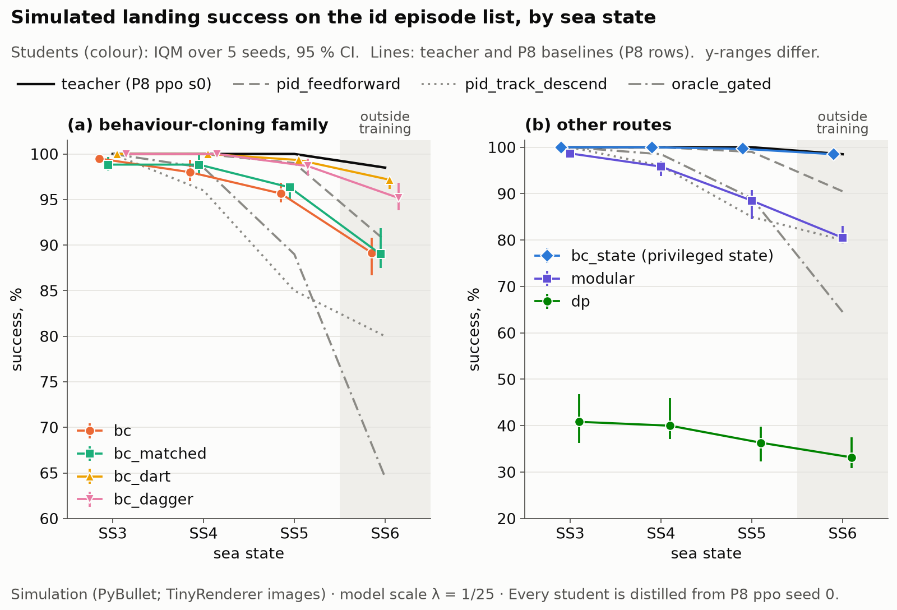
</picture>

*Simulated landing success on P8's frozen `id` list (frigate, aft pad, JONSWAP seas), 200 episodes
per sea state. Students are shown as IQM over 5 seeds with 95 % stratified-bootstrap CIs. The
teacher and baselines are point rates from P8's committed rows. SS6 is outside the training
distribution. Note that the two panels have different y-ranges.*

- **The teacher is at the ceiling.** It lands 100 % at SS3–SS5, so those cells can only show a
  student losing to it.
- **The BC family stays close to it.** `bc_dart` and `bc_dagger` stay within 1.3 points of the
  teacher at SS3–SS5 (IQM against a P8 rate; unpaired reading). At SS6 † (flip floor 6.6 %), plain
  `bc` and `bc_matched` drop to 89 %, about where `pid_feedforward` sits (90.5 %; unpaired
  reading).
- **`modular` sits below its own teacher.** It loses −11.9 [−16.3, −8.0] points at `id` SS5 and
  −17.6 [−22.0, −13.3] at `id` SS6 (P8's one-ulp flip floor 6.6 %, measured on P8's MLPs). Its state-estimation error is at or
  slightly above P8's 2 cm / 0.10 m/s perception-noise condition and below 4 cm / 0.20 m/s
  (P7-D3 item 3).

<details>
<summary><b>The full <code>id</code> table</b> (IQM [95 % CI] over 5 × 200 seed-episodes; baselines rate [Wilson 95 %], k/200)</summary>

| arm | SS3 | SS4 | SS5 | SS6 † |
|---|---|---|---|---|
| `bc_state` (P8's 25-d state observation incl. `time_fraction`, BC; privileged by design) | 100.0 [100.0, 100.0] | 100.0 [100.0, 100.0] | 99.7 [99.5, 100.0] | 98.5 [97.8, 98.8] § |
| `bc` (vision BC, 1 000 demos) | 99.5 [99.0, 100.0] | 98.0 [97.0, 99.3] | 95.7 [94.7, 96.8] | 89.2 [86.7, 90.8] |
| `bc_matched` (vision BC, 2 000 demos) | 98.8 [98.2, 99.7] | 98.8 [97.7, 99.8] | 96.3 [95.0, 96.5] | 89.0 [87.5, 91.8] |
| `bc_dart` ‡ (vision BC, DART σ* = 0.10) | 100.0 [99.7, 100.0] | 100.0 [99.7, 100.0] | 99.3 [99.0, 99.5] | 97.2 [96.2, 97.5] |
| `bc_dagger` (vision BC + DAgger, 2 000 labelled) | 100.0 [100.0, 100.0] | 100.0 [99.7, 100.0] | 98.7 [97.7, 99.5] | 95.2 [93.8, 96.8] |
| `dp` (vision Diffusion Policy, Ta = 8, K = 10) | 40.8 [36.3, 46.8] | 40.0 [37.2, 46.0] | 36.3 [32.3, 39.8] | 33.2 [30.8, 37.5] |
| `modular` (estimator + frozen teacher; true `time_fraction` to the teacher) | 98.7 [97.7, 99.7] | 95.8 [93.8, 97.0] | 88.5 [84.5, 90.8] | 80.5 [79.3, 83.0] |
| teacher `ppo` s0 (P8) | 100.0 [98.1, 100.0] 200/200 | 100.0 [98.1, 100.0] 200/200 | 100.0 [98.1, 100.0] 200/200 | 98.5 [95.7, 99.5] 197/200 |
| `pid_feedforward` (P8) | 100.0 [98.1, 100.0] 200/200 | 100.0 [98.1, 100.0] 200/200 | 99.0 [96.4, 99.7] 198/200 | 90.5 [85.6, 93.8] 181/200 |
| `pid_track_descend` (P8) | 100.0 [98.1, 100.0] 200/200 | 96.0 [92.3, 98.0] 192/200 | 85.0 [79.4, 89.3] 170/200 | 80.0 [73.9, 85.0] 160/200 |
| `oracle_gated` (P8; privileged commit-timing oracle, not a bound) | 100.0 [98.1, 100.0] 200/200 | 98.5 [95.7, 99.5] 197/200 | 89.0 [83.9, 92.6] 178/200 | 64.5 [57.7, 70.8] 129/200 |

† Outside the training distribution; no SS6 or 90° episode was used in any training, tuning or
selection. ‡ `bc_dart` seed 0 is the σ-tuning trial (see the hypothesis footnotes). § One seed is
above the teacher; this was audited (below).

</details>

### Under shift: other decks, headings and sea states

<picture>
  <source media="(prefers-color-scheme: dark)" srcset="docs/figures/conditions_dark.png">
  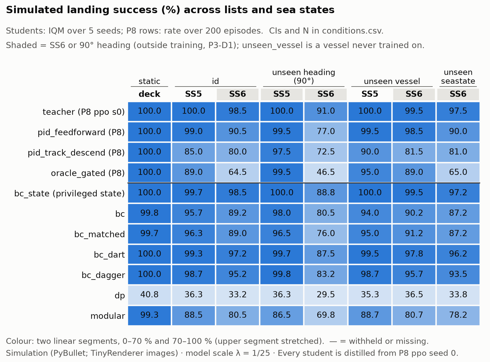
</picture>

*Success (%) on all five frozen lists at SS5 and SS6: the `static` deck, `id`, `unseen_heading`
(90°), `unseen_vessel` and `unseen_seastate`. Shaded columns are outside the training
distribution. Students are shown as IQM over 5 seeds and P8 rows as a rate over 200 episodes; the
CIs and N are in `docs/figures/conditions.csv`. In simulation.*

- **The ordering holds on every list** (point estimates, unpaired reading; several neighbouring
  pairs are within each other's CIs). It is the same as on `id`: `bc_dart` and `bc_dagger` are
  closest to the teacher, and plain BC and `modular` lose more as the sea state rises.
- **`dp` stays low.** In the plotted cells (SS5, SS6 and static), `dp` stays between 29.5 and
  40.8 %. Across all 14 core cells it ranges 29.5–46.8 % (IQM; `results/e08/aggregate.csv`).
- **The static deck.** On it, `dp` lands 40.8 %, about as often as at `id` SS3–SS4 (unpaired
  reading), so deck motion is not its main source of loss.

### How episodes end: successes and failures

<picture>
  <source media="(prefers-color-scheme: dark)" srcset="docs/figures/outcomes_dark.png">
  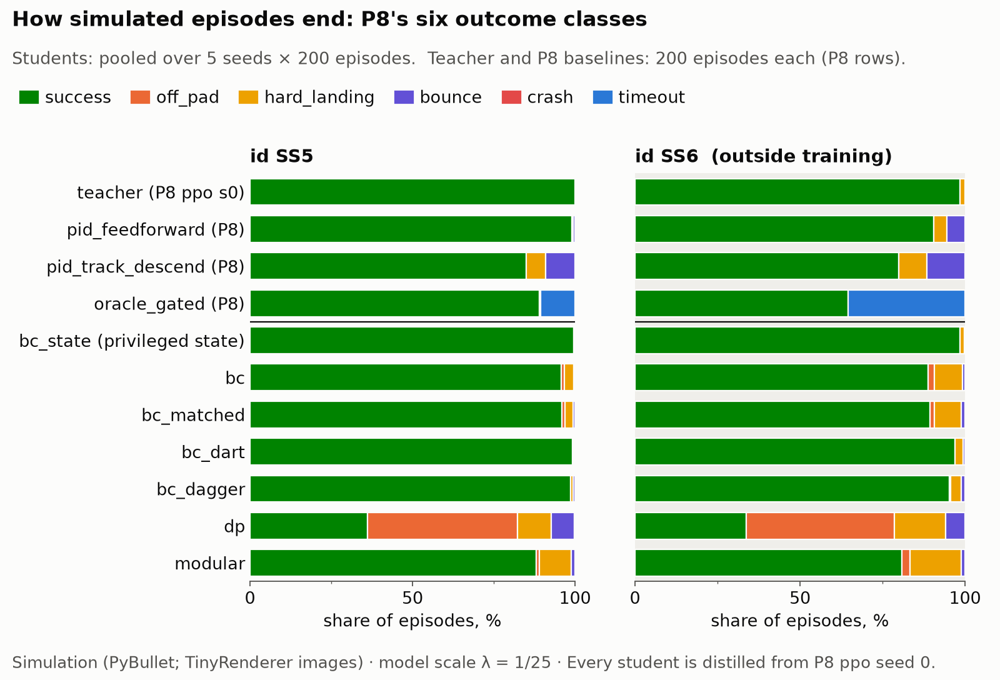
</picture>

*P8's six outcome classes per arm at `id` SS5 and SS6. Students are pooled over 5 seeds × 200
episodes; the teacher and baselines show 200 episodes each. In simulation.*

- **`dp`'s main failure is `off_pad`.** At `id` SS5 it lands `off_pad` in 462 of 1 000
  seed-episodes, more often than it succeeds (361), with some hard landings (103) and bounces (72).
  - `off_pad` means the centre touched down more than 0.10 m (model scale) from the pad centre,
    which is the lateral criterion.
  - The painted ring is wider (0.15 m, context only, per P8's `success.yaml`). So in the GIFs a
    `dp` drone can sit on the ring under an `off_pad` badge.
- **The BC students fail by landing hard.** Their few failures are mostly `hard_landing`.
- **`oracle_gated` times out.** All 71 of its 200 `id` SS6 failures are timeouts.

Success alone hides hovering, timeouts and crashes, so the complete breakdown is in
`results/results.md` §3.

**Students above their own teacher.** In six cells a student, or one of its seeds, sits above its
own teacher: three `bc_state` SS6 cells, two `bc_mix` cells and one appearance-shift cell. Each was
audited for touchdowns and exploits, then released by `results-skeptic` before reporting
(`results/e08/above_teacher/audit.md`).

Sources: `results/results.md` §2–§4 and §7; `results/e08/summary.csv`, `aggregate.csv` and
`baselines.csv`; figure data in `docs/figures/{success_id,conditions,outcomes}.csv`.

## Gallery

<table>
<tr><td><b>(a) all four land</b> · <code>id</code> SS5</td></tr>
<tr><td>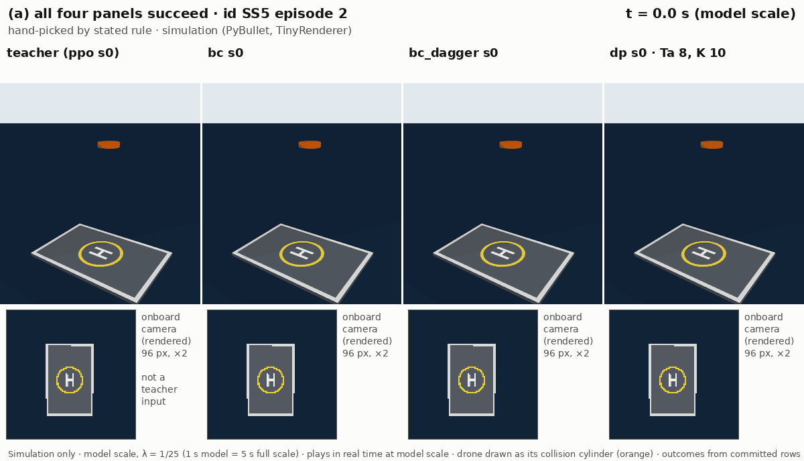</td></tr>
<tr><td><b>(c) <code>dp</code> lands <code>off_pad</code> (centre more than 0.10 m from the pad centre)</b> · <code>id</code> SS5</td></tr>
<tr><td>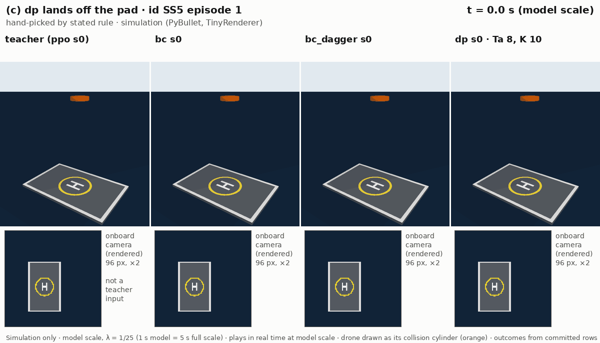</td></tr>
<tr><td><b>(d) the teacher fails, outside training</b> · <code>id</code> SS6</td></tr>
<tr><td>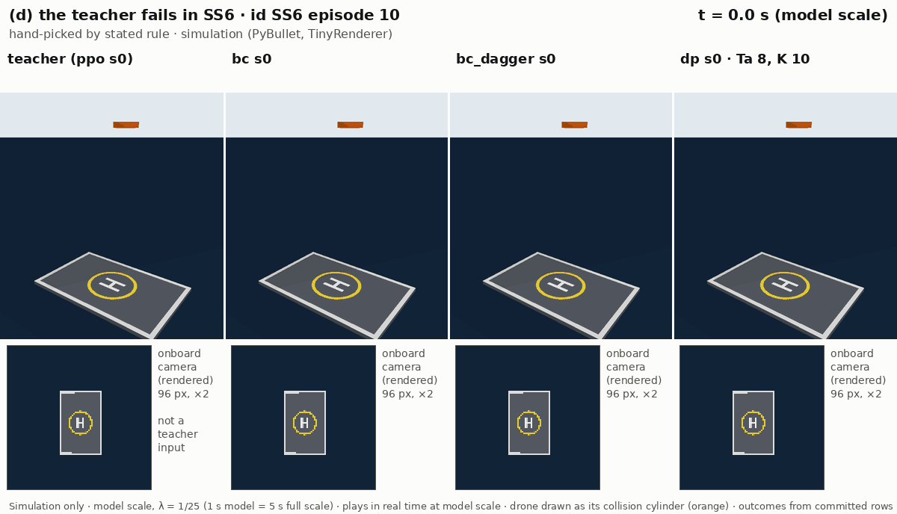</td></tr>
</table>

Panel (b) is the GIF at the top of this page. In (d) the teacher lands hard, `bc` and `bc_dagger`
succeed, and `dp` lands `off_pad`. It is a single episode, not a rate.

The four episodes were **hand-picked by the rule in [`RULE.md`](results/e08/gifs/RULE.md)**, which
was fixed before any GIF was made:
- **Panels:** the teacher, `bc`, `bc_dagger` and `dp`, all seed 0.
- **Re-flight check:** each panel was re-flown and checked equal to its committed row before it
  was written (`docs/media/manifest.json`).
- **Onboard frames** turn uniform background once the vehicle rests on the deck (see the camera
  box below).
- **The outside view** draws the drone as its collision cylinder, in orange. It is an
  illustration, and no student ever sees it.

<details>
<summary>The original onboard-only gallery (Phase 8)</summary>

| (a) all four land, `id` SS5 | (b) the students split, `id` SS5 |
|---|---|
| 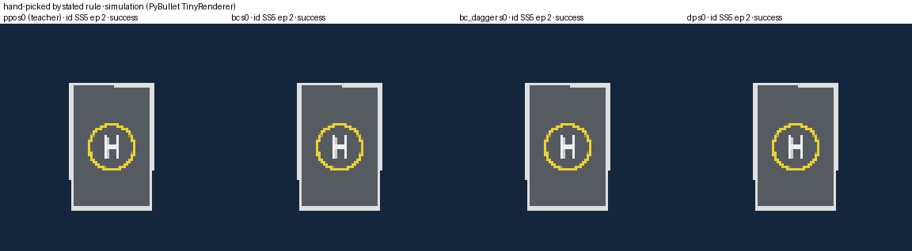 | 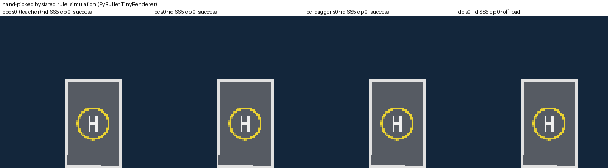 |
| **(c) `dp` lands off the pad, `id` SS5** | **(d) the teacher fails, `id` SS6** |
| 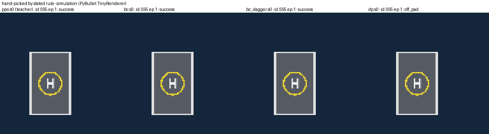 | 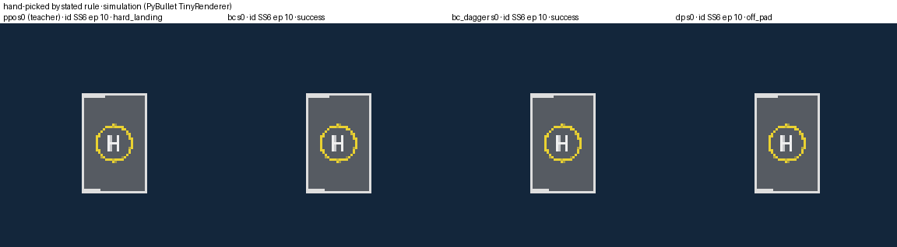 |

</details>

## Where the shortfall comes from (H4)

<picture>
  <source media="(prefers-color-scheme: dark)" srcset="docs/figures/gaps_dark.png">
  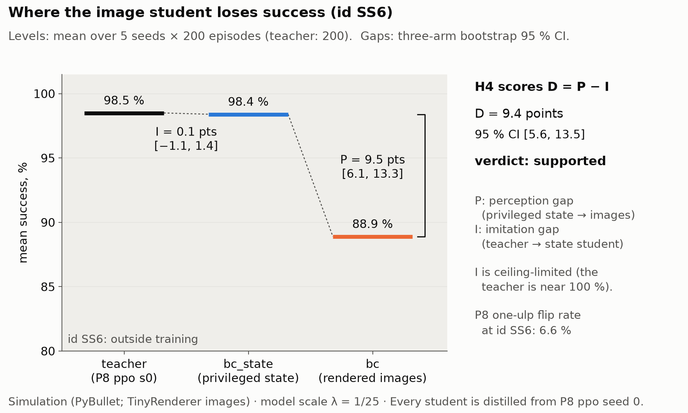
</picture>

*Mean success at `id` SS6 for the teacher, `bc_state` (the same BC recipe on privileged state) and
`bc` (on rendered images). The imitation gap I = S(teacher) − S(`bc_state`); the perception gap
P = S(`bc_state`) − S(`bc`). In simulation. P8's SS6 one-ulp flip floor is 6.6 %.*

- **The imitation gap is near 0**, and it is ceiling-limited: the teacher is at 98.5 %.
- **Almost all of `bc`'s SS6 shortfall is the step from state to pixels.** That step also removes
  the clock (`time_fraction`) and changes training from fp32 to bf16. So P is "perception plus
  those two", not perception alone.

Sources: `results/e08/hypotheses.csv` (H4); figure data in `docs/figures/gaps.csv`.

## The chunking curve (H3)

<picture>
  <source media="(prefers-color-scheme: dark)" srcset="docs/figures/chunking_dark.png">
  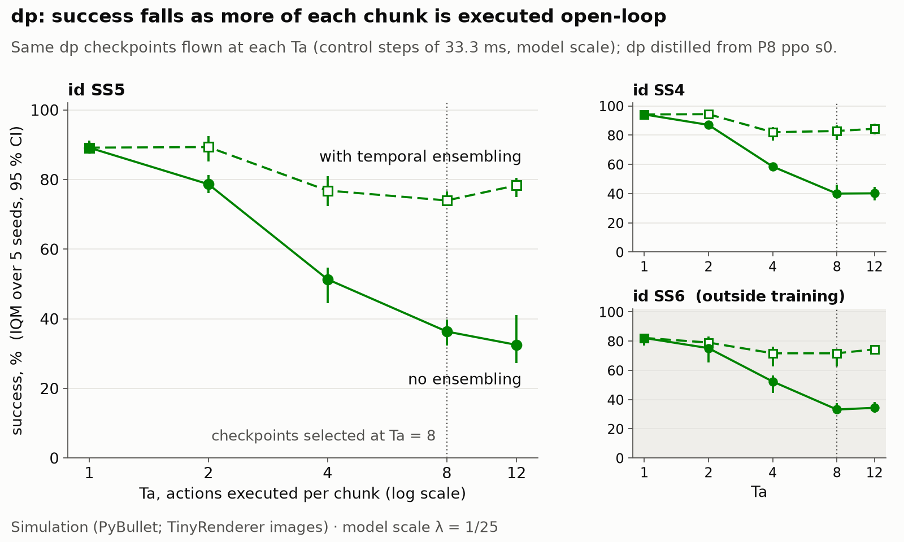
</picture>

*Success of this `dp` (distilled from P8 `ppo` s0) against Ta: without ensembling, the number of
actions executed per predicted chunk; with ensembling, the averaging window, on the same checkpoints with K = 10. Results are shown with and without temporal
ensembling. In simulation.*

- **Shorter chunks recover most of the loss.** With temporal ensembling, `dp` replans every step
  and Ta is only the averaging window, so the two curves are identical at Ta = 1 by construction.
  The ensembled curve still falls as Ta grows (at `id` SS5, IQM 89.2 % at Ta = 1 and 74.0 % at
  Ta = 8), with no open-loop
  execution. That fits the stale-input explanation below as well as chunk length.
- **The checkpoints were selected at Ta = 8**, so the curve is not a fair tuning of each Ta.
- **This is consistent with a stale `last_action` copycat channel.** Feeding `dp` its own executed
  previous action raises open-loop lateral RMSE by 29–38 % (P7-D3 item 7). That is a competing
  explanation to chunk length.
- **Seed 0's `dp` is numerically sensitive.** It flips 21–29 % of 150 `select` outcomes under
  numeric perturbations of order 1e-5 (P9-D2 item 1).
- **Even at Ta = 1, `dp` is below `bc`.** It lands a mean of 139.0/150 on `select`, still below
  `bc`'s 145–149 in every seed (unpaired; P6-D5).

Sources: `results/e08/figures/h3_ta_curve.csv`; `results/results.md` §7; figure data in
`docs/figures/chunking.csv`.

## Deployment: ONNX export and latency

<picture>
  <source media="(prefers-color-scheme: dark)" srcset="docs/figures/latency_dark.png">
  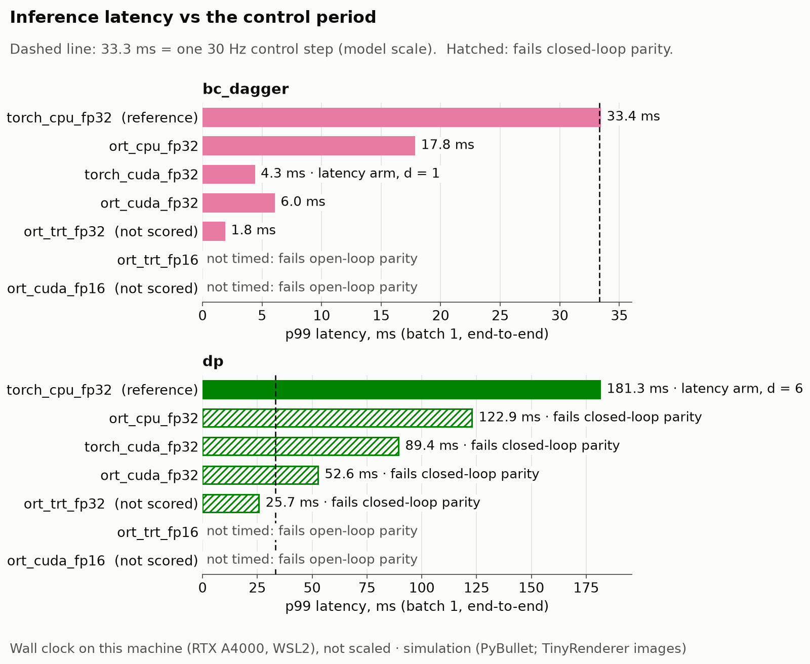
</picture>

**What was exported.** `bc_dagger` (seed 0) and this `dp` (seed 0) were exported to ONNX at
opset 17, fp32 and fp16, with the noise as an input and no RNG op.

**How it was timed.** Each export was checked for parity and timed with P8's latency harness: at
least 200 warm-up calls, then at least 2 000 timed, synchronised calls, at batch 1, with one thread
on CPU. Wall clock is on this machine (Intel i9-10980XE, RTX A4000, WSL2), not Froude-scaled.
Nothing here transfers to an embedded target.

| provider | `bc_dagger` e2e p50 / p99 (ms) | `dp` e2e (K = 10) p50 / p99 (ms) | `dp` closed-loop flips / 150 |
|---|---|---|---|
| torch CPU fp32 (reference, 1 thread) | 28.6 / 33.4 | 166.3 / 181.3 | reference |
| ORT CPU fp32 (1 thread) | 15.8 / 17.8 | 111.6 / 122.9 | 33 |
| ORT CUDA fp32 | 3.0 / 6.0 | 48.3 / 52.6 | 44 |
| torch CUDA fp32 | 3.7 / 4.3 | 80.7 / 89.4 | 32 |
| ORT TensorRT fp32 (unscored) | 1.2 / 1.8 | 19.8 / 25.7 | 46 |
| ORT TensorRT fp16, ORT CUDA fp16 | refused: open-loop parity failed | refused | — |

- **Open-loop parity.** On 1 000 teacher-visited `select` inputs, the three scored fp32 providers
  pass for both arms against a bound of 1e-4: `dp` per-step ε̂ ≤ 2.96e-5, `bc_dagger` action
  ≤ 3.04e-6.
- **Closed-loop parity** (≤ 3 of 150 flips) **passes for `bc_dagger`** (0–2 flips) and **fails for
  `dp`** (32–44 on the three scored providers).
  - `torch_cuda_fp32` runs the same Python sampler as the reference and still flips 32 episodes.
  - So this `dp`'s outcomes are sensitive to numeric perturbations of order 1e-5, while its success
    counts stay near the reference: 58–67 of 150, against 63.
- **The delay d** is ⌈p99 / 33.333 ms⌉ control steps, from the fastest **scored** provider that
  passes both parities; if none passes, the torch CPU fallback is used.
  - `bc_dagger`: d = 1 (torch CUDA, 4.32 ms).
  - `dp`: d = 6 (fallback, 181.3 ms). d = 2 under ORT CUDA was not flown.
- **H5(b)** compares `dp` with itself: 36.1 % synchronous vs 20.2 % with a 6-step delay (mean over
  seeds × episodes).
  - d = 6 is the delay of the 1-thread CPU fallback, not of a GPU.
  - The delayed side includes 6 zero-action steps at episode start.
  - `last_action` then carries the delayed action, which the student never saw in training.
  - There is no teacher-under-delay reference.

Sources: `results/latency/latency.csv`, `parity.csv`, `closed_loop.csv` and `delay.json`; figure
data in `docs/figures/latency.csv`.

> [!NOTE]
> **What a rendered camera can and cannot show.**
> - **The image.** Each frame is a 96 × 96 TinyRenderer rasterisation (PyBullet) of a recoloured
>   ground and a marked deck, from a camera fixed to the vehicle body.
> - **Not modelled:** sensor noise, motion blur, exposure change, rolling shutter, a lens model,
>   weather and spray.
> - **Appearance shift.** The test covers five render variants only: hue, light, contrast, and ±2°
>   mount tilt (`results/results.md` §7c). Robustness claims stay inside them.
> - **Frames at contact.** Once the vehicle rests on the deck, the camera (`offset_body_m` −0.02 m,
>   model scale) sits below the deck surface, and every frame is uniform background until the
>   episode ends. Physics and outcomes are unaffected. The demo stores contain the same frames, and
>   the GIFs show it at every touchdown.

## Limitations

[`docs/LIMITATIONS.md`](docs/LIMITATIONS.md) has these with their evidence (L1–L9 there; the
wording is condensed here).

- **L1 Simulation only.** PyBullet physics, TinyRenderer images and P8's seakeeping motion. Nothing
  was flown, filmed or measured outside the simulator.
- **L2, L3 The rendered camera.** See the box above.
- **L4 Outcome sensitivity of the Diffusion-Policy students.** Seed 0 of each arm was flown on
  `select` (`results/phase10/dp_sensitivity/sensitivity.csv`, P10-D2). The perturbation is the same
  sampler run in torch on the GPU against the CPU reference, with numeric differences of order 1e-5.

  | arm | flips of 150 |
  |---|---|
  | `dp` | 32 |
  | `dp_mix` | 22 |
  | `dp_pid` | 5 |
  | `dp_n100` | 43 |
  | `dp_n300` | 35 |
  | `dp_minus_last_action` | 37 |

  - `dp`'s 32 reproduces Phase 9 exactly, and every reference flight equals its selection rows byte
    for byte.
  - P8's single-draw one-ulp floor (median 1.9 %) was measured on P8's MLPs under a different
    perturbation, so it is context, not a like-for-like bound.
  - Byte-identical rows for `dp`, `dp_*` and R1 hold only on this software stack: torch 2.13.0 on
    the CPU fp32 single-sample path, and for R1, ONNX Runtime CPU with one thread.
- **L5 Ceilings and thin margins.**
  - Both H1 primaries are ceiling-limited: their reference arms are within 5 points of 100 % at
    `id` SS5 (`bc_matched` 96.0 %, `bc` 95.7 %, mean over seeds × episodes).
  - Beyond the +5 margin, H1-SS6 clears by 0.9 points and H1-DART-SS6 by 3.1 points. The flip floor
    at SS6 is 6.6 %, measured on P8's MLPs.
  - Every core student comes from one teacher seed, P8 `ppo` seed 0.
- **L6 Latency.**
  - Latency is wall clock on one workstation (RTX A4000, WSL2), not Froude-scaled.
  - H5(b)'s d = 6 is the CPU fallback's delay.
  - `bc_dagger`'s delay cost is one control step: 33.3 ms model scale, 166.7 ms full scale.
  - There is no teacher-under-delay control.
- **L7 Parity inputs** are teacher-visited `select` states, not student-visited ones.
- **L8 Tuning asymmetry.** `bc_dart` had the one permitted search (σ over 3 trials on `select`,
  decided by one episode); `bc` had none.
- **L9 Tunnelled successes.** P8 counts a success even when the touchdown penetration exceeds 5 mm.
  The H1 and H1-DART contrasts print success minus tunnelled successes beside them. Tunnelled
  successes favour the Ta = 8 side of H3, so its direction stands.
- **Selection is optimistic near the ceiling.** Selection on `select` is noise-dominated there, so
  the selected scores are optimistic. Held-out loss is not a selection proxy (P6-D5).
- **Not covered:** other teachers or teacher seeds for the core arms, other vessels in training,
  sensor models beyond TinyRenderer, and any embedded target.

## Reproducing this

**Install.** Use Python 3.12 with build-essential and python3.12-dev, because pybullet builds from
sdist. These are CI's steps (`.github/workflows/ci.yml`):

```bash
git clone --recursive https://github.com/kbasak01/imitation-landing-approach
cd imitation-landing-approach          # in an existing clone: git submodule update --init --recursive
python3.12 -m venv .venv && . .venv/bin/activate
P8=external/rl-land-on-moving-deck
pip install -e $P8/third_party/deck-motion-forecast
pip install -e $P8/third_party/gym-pybullet-drones
pip install -e "$P8[dev]"
pip freeze --exclude-editable > /tmp/p8_constraints.txt
pip install -c /tmp/p8_constraints.txt -e ".[dev]"   # P8's pins as constraints: torch is never re-resolved
```

**From committed files alone** (no checkpoints, no demo store, no GPU). CI runs all of these:

```bash
make lint                                                     # ruff + mypy --strict
pytest -m "not gpu and not checkpoints and not data and not slow"
make report                                                   # results/results.md, byte-identical
make bench-check                                              # results/latency tables, byte-identical
make sensitivity-check                                        # results/phase10/dp_sensitivity re-checked
make figures && git diff --exit-code results/e08/figures      # Phase 8 figures, byte-identical
make readme-figures && git diff --exit-code docs/figures      # this README's figures, byte-identical
make model-specs-check                                        # results/readme/model_specs.json re-derived
```

**What needs more than committed files:**
- **P8's `ppo` seed-0 checkpoint is not publicly released.** Its SHA-256s are in
  `results/p8_provenance.json`. It is needed for:
  - `make verify-p8` and `make reproduce-p8`;
  - `modular` evaluation;
  - DAgger and demo collection;
  - the GIFs.

  To use it, copy `configs/paths.local.example.yaml` to `configs/paths.local.yaml` and point it at
  P8's run directory.
- **Student checkpoints and ONNX graphs are release assets:** 86 files, 16.7 GiB, the largest
  470 MB.
  - **Verify them:** each asset's source path and SHA-256 are in `results/release/manifest.json`.
    Run `sha256sum -c --ignore-missing SHA256SUMS.txt` in the download directory.
  - **Place them:** asset names are flat (`<arm>_s<seed>_<file>`), but the evaluation code looks
    each checkpoint up at its manifest `source` path (`artifacts/runs/…`,
    `artifacts/deploy/graphs/…`). Move each asset to that path.

| stage | wall clock (this machine) | source |
|---|---|---|
| reproduction gate (`make reproduce-p8`, 24 workers) | 253 s | `results/reproduce_p8/rerun_phase10/run_info.json` |
| demo collection (6 stores) | 52–102 s each | `results/demos_summary.json` (`manifest.wall_s`) |
| training, all 71 pinned runs plus 3 σ trials (one RTX A4000) | 95.4 GPU-h (17.5 + 7.1 + 19.8 + 51.0) | `results/phase{4,5,6,7}/runs_summary.csv` (`gpu_hours`) |
| evaluation matrix (`make eval`, CPU, 24 workers) | 22.3 h, summed over jobs | `results/e08/run_info.json` |
| `dp_*` sensitivity (`make sensitivity`) | 2–4 min per arm (115–253 s) | `results/phase10/dp_sensitivity/run_info.json` |
| `make test` (full suite, workstation) | 23 min 25 s | `docs/LIMITATIONS.md` |

**Notes on the run records:**
- **Order of operations.** The full order is in the `Makefile` and
  `docs/IMPLEMENTATION_PLAN.md`. Long jobs are resumable, and they refuse to start on a dirty tree.
- **Absolute paths.** Paths inside committed run records are absolute paths on the machine that
  produced them. They record provenance and are not instructions.
- **Agent instructions.** `CLAUDE.md`, `KICKSTART.md`, `REPO_SETUP.md`, `VALIDATION_CHECKLIST.md`
  and `.claude/` hold the instructions the coding agent worked under.

## How this relates to prior work

The closest prior work is Angelis, Bauersfeld, Scaramuzza and Boukas, *Vision-Based Agile Landing
on Turbulent Waters* (arXiv:2605.23717). It lands on a moving platform from a downward camera:
- PPO with an attention encoder on 25 sparse keypoints from a downward camera, trained in
  simulation (Aerial Gym);
- sinusoidal per-DoF platform motion;
- hardware tests;
- no teacher, demonstrations or distillation.

This repository is simulation-only and does not compare with it numerically.

Privileged-teacher → sensor-based-student distillation is established for driving and flight (Chen
et al. 2019; Kaufmann et al. 2020; Loquercio et al. 2021; Xing et al. 2024; Messikommer et al.
2026). So are DAgger, DART, Diffusion Policy and action chunking. **No novelty is claimed for
distillation, for Diffusion Policy, or for vision-based landing.**

What this repository adds:
1. a matched-data comparison of BC, DART, DAgger, Diffusion Policy and a modular pipeline on P8's
   frozen, seakeeping-driven protocol, with P8's classical baselines beside every student;
2. a chunk-length study at a fixed model (H3);
3. a decomposition of the shortfall into imitation and perception gaps (H4);
4. deployment numbers for the visuomotor policy, with the measured delay put back into the loop
   (H5).

P8 supplies the environment, protocol, frozen lists, success criteria, statistics and teachers.

## Statistics

- **Students:** IQM with stratified-bootstrap 95 % CIs.
- **Contrasts:** paired bootstrap.
- **P8's functions, by identity (tested):** Wilson, IQM and paired bootstrap.
- **Three statistics are this repository's**, each with known-answer tests (`ila.eval.stats`;
  P3-D1 §1): the joint-seed contrast (H3, H5(b)), the W₁ bootstrap (H2) and the three-arm bootstrap
  (H4).
- **Pooling and correction:** sea states are never pooled, and no multiplicity correction is
  applied.
- **Evaluation path:** every evaluation row was flown on the CPU fp32 single-sample path: 185 200
  rows (`results/e08/run_info.json`) in 961 cells (`results/e08/summary.csv`).

## Documentation

| file | what |
|---|---|
| [`docs/IMPLEMENTATION_PLAN.md`](docs/IMPLEMENTATION_PLAN.md) | the plan, phase by phase, with its gates |
| [`docs/protocol.md`](docs/protocol.md) | every decision, deviation and gate, dated; P3-D1 is the frozen protocol |
| [`docs/LIMITATIONS.md`](docs/LIMITATIONS.md) | the validation checklist, line by line, with evidence |
| [`docs/audit_report.md`](docs/audit_report.md) | the Phase 10 full audit |
| [`results/results.md`](results/results.md) | every table, generated from committed files |
| [`results/readme/model_specs.json`](results/readme/model_specs.json) | controller and network specs, with parameter counts |
| [`docs/figures/`](docs/figures/), [`docs/media/`](docs/media/) | this README's figures (each with the CSV it plots) and GIFs (with their manifest) |
| [`SOURCES.md`](SOURCES.md), [`docs/LICENSES.md`](docs/LICENSES.md), [`THIRD_PARTY_NOTICES.md`](THIRD_PARTY_NOTICES.md) | sources, licences and notices |

## Citations

- P8: K. Basak, *rl-land-on-moving-deck*, <https://github.com/kbasak01/rl-land-on-moving-deck>,
  commit `7237b70`.
- A. Angelis, L. Bauersfeld, D. Scaramuzza, N. Boukas, *Vision-Based Agile Landing on Turbulent
  Waters*, arXiv:2605.23717.
- D. Chen, B. Zhou, V. Koltun, P. Krähenbühl, *Learning by Cheating*, CoRL 2019.
- E. Kaufmann, A. Loquercio, R. Ranftl, M. Müller, V. Koltun, D. Scaramuzza, *Deep Drone
  Acrobatics*, RSS 2020.
- A. Loquercio, E. Kaufmann, R. Ranftl, M. Müller, V. Koltun, D. Scaramuzza, *Learning High-Speed
  Flight in the Wild*, Science Robotics 2021.
- J. Xing, A. Romero, L. Bauersfeld, D. Scaramuzza, *Bootstrapping Reinforcement Learning with
  Imitation for Vision-Based Agile Flight*, CoRL 2024.
- N. Messikommer, J. Xing, L. Bauersfeld, M. Cannici, E. Aljalbout, D. Scaramuzza, *Approximate
  Imitation Learning for Event-based Quadrotor Flight in Cluttered Environments*, arXiv:2603.07578.
- S. Ross, G. Gordon, D. Bagnell, *A Reduction of Imitation Learning and Structured Prediction to
  No-Regret Online Learning*, AISTATS 2011.
- M. Laskey, J. Lee, R. Fox, A. Dragan, K. Goldberg, *DART: Noise Injection for Robust Imitation
  Learning*, CoRL 2017.
- C. Chi et al., *Diffusion Policy: Visuomotor Policy Learning via Action Diffusion*, RSS 2023.
- T. Z. Zhao, V. Kumar, S. Levine, C. Finn, *Learning Fine-Grained Bimanual Manipulation with
  Low-Cost Hardware*, RSS 2023.
- J. Song, C. Meng, S. Ermon, *Denoising Diffusion Implicit Models*, ICLR 2021.
- P. de Haan, D. Jayaraman, S. Levine, *Causal Confusion in Imitation Learning*, NeurIPS 2019.
- C. Wen, J. Lin, T. Darrell, D. Jayaraman, Y. Gao, *Fighting Copycat Agents in Behavioral Cloning
  from Observation Histories*, NeurIPS 2020.
- J. Panerati et al., *Learning to Fly — a Gym Environment with PyBullet Physics for Reinforcement
  Learning of Multi-agent Quadcopter Control*, IROS 2021.
- R. Agarwal, M. Schwarzer, P. S. Castro, A. Courville, M. G. Bellemare, *Deep Reinforcement
  Learning at the Edge of the Statistical Precipice*, NeurIPS 2021.
- K. He, X. Zhang, S. Ren, J. Sun, *Deep Residual Learning for Image Recognition*, CVPR 2016.
- J. Schulman, F. Wolski, P. Dhariwal, A. Radford, O. Klimov, *Proximal Policy Optimization
  Algorithms*, arXiv:1707.06347.

## License

MIT ([LICENSE](LICENSE)). Release assets (checkpoints, ONNX graphs) are under the same licence.
Third-party notices: [`THIRD_PARTY_NOTICES.md`](THIRD_PARTY_NOTICES.md).
